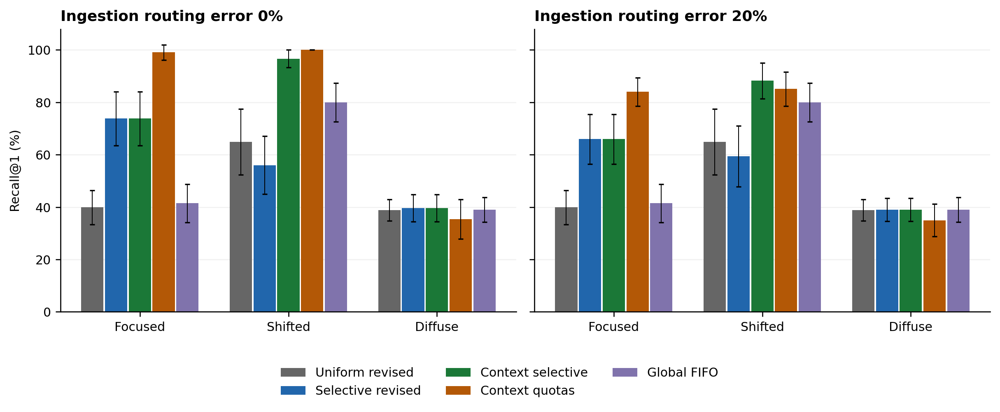

Independent researcher and undergraduate student at Universidade Federal do Rio de Janeiro, Brazil

Contact: cleilson.elias@nano.ufrj.br

# Abstract

Valued Asymmetric Lambda (VAL) assigns a separate inhibition parameter to each domain of an external memory controller. This paper formulates the mechanism as admission and retrieval under finite resources. It establishes monotonicity of admission with respect to inhibition, separates this property from useful retention, and replaces an earlier unrestricted superiority claim with conditional statements and counterexamples. A revised shadow rule evaluates admission and archival on the same score scale, removing an unintended discard interval. An executable study compares nine policies across sixteen random seeds, three query scenarios and two routing error levels, yielding 864 runs. All policies share a ceiling of 128 retained episodes; realized occupancy and serialized payload are reported separately. Without routing error, fixed selective VAL reaches {{FOCUS_SELECTIVE}} Recall@1 against {{FOCUS_UNIFORM}} for a uniform threshold, while fixed domain quotas reach {{FOCUS_QUOTA}}. After a target change, context-driven VAL reaches {{SHIFT_ADAPTIVE}} and context-driven quotas {{SHIFT_QUOTA}} when both receive the same external target signal. Removing score amplification produces no measured retrieval difference in this protocol. These findings support domain allocation as a task-dependent engineering mechanism, while leaving its advantage over simpler controllers unresolved. The experiments evaluate synthetic episodic retrieval; they do not establish creativity, consciousness or biological equivalence.

**Keywords** external memory; domain allocation; memory admission; resource constraints; retrieval; adaptive inhibition

# 1 Introduction

A memory system with finite storage must decide which observations to retain, which evidence to retrieve and how to respond when the task changes. A single admission threshold is simple, but it applies the same score cutoff to domains whose future relevance can differ. VAL replaces that scalar control with a domain-indexed vector. The architectural question is whether the extra freedom improves useful retrieval under an explicit budget, and whether any improvement survives comparison with simpler allocation policies given the same task information.

The earlier VAL manuscript [7] presented domain selectivity through the language of hyperfocus, connective density and consciousness. Its general superiority claim required assumptions that were not established, including an implication from more admitted observations to greater graph density and from graph density to cognitive performance. Here, VAL is defined through observable operations and evaluated outcomes. Biological findings remain a source of motivation, rather than a derivation of the controller or a validation of its parameters.

The contributions are a complete admission and archival specification; two limited propositions with proofs; explicit failure cases for stronger conclusions; and a reproducible comparison of threshold control, domain quotas and global FIFO retention. The revision also separates the implemented memory controller from optional plans for adapter training and generative replay. The scope is a research reference for studying selective memory, with no claim to be a complete cognitive architecture.

# 2 Background and relation to prior work

## Biological motivation

Carson, Peterson and Higgins [1] report an association between reduced latent inhibition and creative achievement in youthful high-IQ samples. This motivates studying the consequences of filtering, but it does not identify a domain-specific neural parameter or determine an artificial threshold law. Dwyer and colleagues [2] relate hyperfocus and inattention in questionnaire data from 492 adults and describe both favorable and unfavorable experiences of hyperfocus. Their observations do not establish an equivalence between a human cognitive profile and a vector of memory parameters. Snyder [3] proposes privileged access to less processed information as a hypothesis about savant abilities. That proposal does not imply that changing one software parameter creates abilities already present in an arbitrary network.

Accordingly, the fixed selective, uniform and context-driven configurations below are engineering policies. The earlier clinical archetype labels are not used as explanatory categories for people. No clinical benefit, change in psychiatric risk or induction of a biological state is inferred from the experiments.

## External memory systems

Retrieval-augmented generation combines parametric language models with explicit non-parametric retrieval [4]. MemGPT describes management of memory tiers for language models with limited context [5]. Generative Agents incorporates stored experiences, reflection and retrieval into agent behavior [6]. These established directions already make memory storage, movement and selection substantive architectural choices. VAL addresses the narrower question of assigning domain-specific admission cutoffs and evaluating their consequences under a stated retention policy.

The present study does not reproduce those systems, compare their language performance or claim that vector-valued resource allocation is itself unprecedented. The contribution is the specification and examination of this controller, including cases where simple quotas perform better. Broad architectural positioning for [4-6] uses the primary-source abstracts; no result from those papers is imported as evidence for VAL.

# 3 Controller specification

## Inputs and domain routing

An observation at event n consists of evidence text, an identifier, a unit embedding, routing affinities and a selection score. Routing and scoring may come from different representations. For K domains, let

$$
\mathbf p_n\in\Delta^{K-1},\quad k_n=\arg\max_k p_{n,k},\quad \|\widehat{\mathbf x}_n\|_2=1,\quad h_n\in[0,1].\qquad\text{(1)}
$$

The implementation normalizes nonnegative routing affinities and resolves ties by the smallest domain index. It fixes the embedding dimension on the first observation. The host must maintain the identity of the encoder: equal dimensions alone do not establish a shared representation. Secondary domain memberships can annotate graph nodes; they do not cause an observation to pass a second admission gate.

An optional score inherited from the scalar controller is

$$
H_R(\mathbf p)=-\sum_{i\ne j}p_i p_j\log_2(p_i p_j)=-2\sum_i p_i(1-p_i)\log_2 p_i.\qquad\text{(2)}
$$

Terms with zero probability contribute zero. The off-diagonal products sum to one minus the sum of squared probabilities, so this quantity is not Shannon entropy over a normalized distribution of distinct pairs. A bounded convention is $h=H_R/(2\log_2 K)$ for $K\ge2$, with $h=0$ for $K=1$. Indeed $H_R$ does not exceed twice the Shannon entropy of $\mathbf p$, which does not exceed $2\log_2 K$. For four equal probabilities this convention gives $h=0.75$. Neither this normalization nor the word relational makes h a measure of truth or usefulness.

When the score is calculated from routing, sharply assigned inputs can receive low values, including useful facts from a single domain. The experiments therefore use an externally supplied score with a declared distribution. They do not validate Equation 2 as an estimator of useful future memory.

## Admission and finite retention

The inhibition vector and domain thresholds are

$$
\boldsymbol\Lambda_n=(\lambda_{1,n},\ldots,\lambda_{K,n})\in[0,1]^K,\quad
\theta_k=\theta_{\min}+(\theta_{\max}-\theta_{\min})\lambda_k.\qquad\text{(3)}
$$

Assume $0\le\theta_{\min}<\theta_{\max}\le1$. An observation is admitted to the active pool when

$$
G_n=\mathbf 1\{h_n>\theta_{k_n}\}.\qquad\text{(4)}
$$

The inequality is strict. At $\lambda=0$, scores at or below $\theta_{\min}$ remain rejected. At $\lambda=1$, scores above $\theta_{\max}$ still pass. Complete permeability or complete blockade would require an explicit endpoint policy or a suitable threshold and score support; neither is silently added here. Uniform components recover scalar admission, although domain-specific historical baselines remain different from a single global baseline.

Active episodes and shadow episodes occupy disjoint pools $I_n$ and $S_n$, with capacities $B_I$ and $B_S$. FIFO eviction is applied independently within each pool. A gate decision is consequently different from continued retention: passing the gate does not guarantee that an episode survives until a future query. Active eviction does not automatically create a shadow. Text is retained with shadow vectors, so factual evidence returned from a shadow is stored evidence, rather than reconstruction of erased text.

## A consistent shadow rule

Let the lower archival cutoff be $\ell_k=c_s\lambda_k$, with $0\le c_s\le\theta_{\max}$. This ensures $\ell_k\le\theta_k$ throughout the allowed inhibition range. The revised archival rule is

$$
A_n=\mathbf 1\{G_n=0\}\,\mathbf 1\{\ell_{k_n}<h_n\le\theta_{k_n}\}.\qquad\text{(5)}
$$

Admission and archival now use the same score. An observation is active if it passes Equation 4, archived if it satisfies Equation 5, and discarded otherwise. Pool overflow can subsequently evict retained episodes. An observation exactly at $\theta_k$ is eligible for archival when it exceeds $\ell_k$; equality at the lower cutoff is rejected.

The earlier rule instead compared an amplified score $a_kh_n$ with $\theta_k$, where $a_k=1+(1-\lambda_k)\delta_{\max}$. For $a_k>1$, a rejected observation with $\theta_k/a_k\le h_n\le\theta_k$ could fail archival solely because amplification crossed the upper shadow boundary. Equation 5 removes that unintended gap. The legacy interval is retained only as an explicit experimental control, and the revised study identifies which rule each result uses.

## Calibrated urgency and retrieval

Amplification is treated as a configurable priority scale, not as an increase in information:

$$
a_k=1+(1-\lambda_k)\delta_{\max},\qquad \widetilde h_{n,k}=a_k h_n.\qquad\text{(6)}
$$

A historical baseline of raw scores is updated after an observation has been evaluated, only for its primary domain:

$$
\overline h_{k,n}=(1-\gamma)\overline h_{k,n-1}+\gamma h_n,\quad 0<\gamma\le1.\qquad\text{(7)}
$$

For a query score $h_q$, urgency uses the current scale for both query and baseline:

$$
\Omega(q,k)=\sigma\!\left(\alpha_\Omega a_k[h_q-\overline h_k]\right),\quad
\sigma(z)=\frac{1}{1+e^{-z}}.\qquad\text{(8)}
$$

For fixed λ this is equivalent to maintaining an EMA of the scaled scores with a correspondingly scaled prior. When λ changes, scaling the raw historical baseline with the current value avoids artificial novelty caused only by a unit change. At $h_q=\overline h_k$, urgency equals one half for every λ. Lower inhibition does not imply permanently elevated surprise.

Active episodes with positive cosine similarity are eligible for retrieval. A shadow from primary domain k is eligible when

$$
\langle\widehat{\mathbf q},\widehat{\mathbf s}\rangle\,\Omega(q,k)>\delta_{\mathrm{res}}.\qquad\text{(9)}
$$

Eligible episodes are ranked by cosine similarity, with identifier-based tie breaking. Querying does not promote memories or alter baselines. A joint retrieval indicator for domains k and j can be defined as the product of their binary resonance indicators on the same query. Its empirical frequency is a joint event count; multiplying marginal probabilities would additionally require independence. This indicator is not an outcome measure of creativity and is not used to support the retrieval results below.

# 4 Properties and failure conditions

## Proposition 1 Admission monotonicity

For a fixed domain, score and threshold interval, if $\lambda_a\le\lambda_b$ then the admission indicator at $\lambda_a$ is at least that at $\lambda_b$. If $F_k$ is the cumulative distribution function of the fixed score distribution in domain k, then

$$
\Pr(G=1\mid k,\lambda_k)=1-F_k(\theta(\lambda_k)).\qquad\text{(10)}
$$

**Proof.** Equation 3 is nondecreasing in λ. Therefore the set of scores strictly above the larger threshold is contained in the set strictly above the smaller threshold. Taking probabilities gives Equation 10. No continuity of $F_k$ is required because its definition includes scores equal to the threshold. The ordering is strict only when the distribution assigns positive probability to scores admitted by the lower threshold and rejected by the higher one.

The proposition concerns admission before capacity eviction. It does not assert improved retention, retrieval, graph density or task performance. It also assumes the same score distribution. Feedback that changes observations, scores or routing requires a separate analysis.

## Proposition 2 Discounted admitted score under fixed dynamics

For a single domain, fixed nonnegative weights $w_{tn}$ and nonnegative scores, define an auxiliary scalar trace

$$
D_n(\lambda)=\sum_{t=1}^{n} w_{tn}h_tG_t(\lambda),\quad w_{tn}\ge0.\qquad\text{(11)}
$$

Under the assumptions of Proposition 1, $D_n(\lambda_a)\ge D_n(\lambda_b)$ when $\lambda_a\le\lambda_b$.

**Proof.** Each summand has a fixed nonnegative multiplier and an admission indicator ordered by Proposition 1. Summing preserves the ordering. For exponential forgetting, weights may be chosen as $w_{tn}=\alpha\exp[-\beta(t_n-t_t)]$ with fixed $\alpha,\beta\ge0$, where $t_n$ and $t_t$ are the corresponding event timestamps.

This auxiliary trace is not the norm of a vector memory state. Vectors can cancel, and changing α or β across policies would change the weights assumed in the proposition. The reference implementation separately maintains vector mass using impulses and exponential decay. No monotonicity of its norm is inferred from Equation 11.

## Counterexamples to stronger statements

Consider two domains with $\boldsymbol\Lambda=(0.05,0.95)$, a scalar comparator $\lambda=0.50$ and thresholds $\theta_{\min}=0.10$, $\theta_{\max}=0.90$. Give both controllers two collinear observations of score 0.60, routed to domain two. The selective threshold there is 0.86 and the scalar threshold is 0.50. Selective admission rejects both; scalar admission accepts both. If similar active vectors are connected, the scalar graph can have density one and the selective graph density zero. This is a valid failure case for universal active-retention or graph-density dominance. The score is stipulated as an external input, not computed from the two routing probabilities.

Graph density can also decrease when a memory is added. Two connected nodes have density one; adding an isolated node yields density one third. A claim about node accumulation cannot substitute for a claim about normalized density. Neither graph density nor a sum weighted by inverse λ establishes a measure of consciousness.

The earlier expression involving $\rho_k/\lambda_k$ was undefined at $\lambda_k=0$ and did not specify a validated mapping from graph statistics to consciousness. It is not used as an objective or result in this formulation. Even as a purely structural diagnostic, a regularized expression $\sum_k\rho_k/\max(\lambda_k,\varepsilon)$, with $\rho_k\in[0,1]$ and $\varepsilon>0$, has upper bound $K/\varepsilon$. It cannot justify unbounded divergence of that diagnostic.

Finally, a universal shadow-to-active ratio does not follow from low inhibition. If raw scores are uniform on [0,1], $\lambda=0.05$, $\theta_{\min}=0.1$, $\theta_{\max}=0.9$, $\delta_{\max}=0.9$ and $c_s=0.12$, the legacy rule yields admission probability 0.86 and shadow probability approximately 0.07224. Their flow ratio is about 0.084, rather than greater than ten. Retained stocks would additionally depend on capacities and eviction. Numerical multipliers proposed in [7] therefore require explicit distributions and validation, rather than being architectural constants.

# 5 Task value and adaptation

The term valued refers to an externally specified task objective. A possible design objective is expected retrieval utility minus storage and switching costs:

$$
J(\boldsymbol\Lambda)=\mathbb E[U(\text{retrieval},\text{task})]-\kappa\mathbb E[C_{\mathrm{store}}]-\nu\mathbb E[C_{\mathrm{switch}}].\qquad\text{(12)}
$$

Equation 12 specifies what a learned controller would need to optimize; it is not a learned objective in the reported study. The hard gate in Equation 4 is discontinuous and has no ordinary useful gradient with respect to λ almost everywhere. A practical optimizer would need a surrogate, finite-difference estimates, policy gradients or a derivative-free procedure, validated against the discrete objective on held-out data.

When the host supplies utility and cost gradients for a differentiable objective, the projected update has the sign

$$
\boldsymbol\Lambda_{n+1}=\Pi_{[0,1]^K}\left[\boldsymbol\Lambda_n+\eta(\nabla V-\nabla C)\right].\qquad\text{(13)}
$$

Here C collects the penalized storage and switching costs in Equation 12. This is ascent on V−C, equivalently descent on −V+C. The earlier negative gradient of V would decrease a quantity defined as value. Projection enforces admissible parameters; it does not prove convergence or optimality of the discrete memory policy.

In the experiment, the context-driven threshold controller receives the new target domain at the midpoint of the shifted scenario. A supplied gradient and step size deterministically change Λ from (0.05,0.90,0.90,0.90) to (0.95,0,1,1). The context-driven quota controller receives the same target signal at exactly the same event. Neither controller learns the task change, intrinsic motivation or future episode relevance. The comparison measures response to supplied context, not autonomous attention allocation.

# 6 Reference implementation

The numerical core is VAL Reference 0.1.0, used without modification in the supplementary revision study. The revised shadow rule is selected through its existing `raw_interval` option. The default of the original software remains the legacy paper interval; installing version 0.1.0 without specifying the option does not select the revised rule. The experiment script makes the choice explicit for every policy.

The implementation provides input validation, unit-vector retrieval, fixed capacities, cosine-based graph diagnostics, EMA baselines, host-provided gradient updates and JSON snapshots in SQLite transactions with expected-revision checks. It keeps graph construction, vector mass and text-bearing episodes as separate objects. No pretrained language model, neural encoder or training service is required. The original core passed 41 local tests; six additional revision checks passed for score-consistent archival, a retention-preserving amplification ablation, equal episode ceilings, context-controlled quotas and matched routing perturbations. These checks assess software behavior and are not empirical tests of cognition.

LoRA rank allocation and REM schedules remain plans rather than training or generation. Their status is not counted as an executed phase or a measured result. A resource-bounded extension is outlined in Appendix B to preserve the architectural question without presenting planned work as completed evidence.

# 7 Experimental methods

## Task and observations

The study evaluates retrieval of random episodic codes from a controlled stream. Each run receives 320 episodes with independent random unit vectors in 12 dimensions. Each episode has a random primary domain among four domains and a random 48-bit textual code. Selection scores are independently uniform on [0.05,0.85]. Consequently, the experiment isolates admission and retention choices; it does not test whether a neural entropy estimator identifies useful information.

There are 96 queries per run, sampled with replacement from the eligible episodes. A query perturbs its target vector by independent Gaussian components with standard deviation 0.02 and is renormalized. A correct response requires the identifier of the target episode to rank first. Returning another code is incorrect. Query scores are fixed at 0.70, so the urgency ablation is conditional on that setting.

## Query scenarios and routing errors

The focused scenario queries only true domain zero. The shifted scenario queries true domain one among episodes received after event 160. The diffuse scenario queries episodes from all domains. The incoming observation stream remains the same kind of four-domain stream in each case; shifted refers to task relevance, not a learned change detector or a change in the incoming domain frequencies.

Routing error is either zero or 20%. On a corrupted observation, the dominant route is reassigned to one of the other three domains. Its routing vector still contains 0.88 on the selected route and 0.04 elsewhere. Query routing uses the true domain. Search considers all domains rather than filtering candidates by query label. The errors therefore test admission allocation and domain baselines, not semantic embedding degradation.

## Policies and resources

All policies share a ceiling of 128 retained episodes. Threshold controllers use 64 active and 64 shadow slots. Quota and global FIFO comparators use 128 active slots and no shadow pool. This gives equal total item ceilings, not identical realized occupancy or byte usage. Quotas allocate (96,13,10,9) slots initially; these values are obtained by deterministic largest-remainder rounding of weights (0.75,0.10,0.075,0.075). The context quota policy swaps the first two quotas at event 160 in the shifted scenario and immediately evicts episodes above the new per-domain limits.

{{POLICY_TABLE}}

The uniform threshold equals the arithmetic mean of the selective vector, 0.6875; mean inhibition is not matched to FIFO or quota policies, which have no inhibition parameter. Both selective thresholds and fixed quotas encode the same prior target domain. Both adaptive policies receive the same target-change signal. Individual query targets and random code labels are not supplied to admission policies.

Shared threshold parameters are $\theta_{\min}=0.10$, $\theta_{\max}=0.90$, $c_s=0.12$, $\gamma=0.05$, initial raw baseline 0.45, urgency gain 6 and resonance cutoff 0.35. Amplification uses $\delta_{\max}=0.90$ unless ablated. Domain rate coupling is disabled; $\alpha=1$ and $\beta=0.02$ apply equally. Neither the mass state nor graph diagnostics are used to decide correctness in the retrieval benchmark.

## Replication and summaries

Sixteen seeds, three query scenarios, two routing error levels and nine policies produce 864 runs. Policies receive identical streams and queries within each seed and condition. Underlying episodes, scores and query targets are also fixed across routing error levels through a separate routing random generator; only ingestion routing changes between those levels. Seeds, observations, outputs and implementation hashes are included in the supplement. No real corpus or trained encoder is used, and no parameter search is reported. The study is a diagnostic analysis of the revision; it was not preregistered and requires independent task-level replication.

The principal measure is mean Recall@1 across seeds. Paired differences are calculated within seeds. Intervals reported as mean difference ±1.96 times the standard error are descriptive summaries of seed variability, without population calibration or multiplicity correction. Serialized episode payload is measured independently of SQLite file size or process RAM. Repeated query sampling and random-vector geometry limit the interpretation of both means and intervals.

# 8 Results

## Retrieval without routing error

{{RESULTS_TABLE_CLEAN}}

The score-consistent selective policy reaches {{FOCUS_SELECTIVE}} in the focused scenario, compared with {{FOCUS_UNIFORM}} for the corresponding uniform threshold. However, fixed quotas reach {{FOCUS_QUOTA}} under the same total episode ceiling and the same prior target information. This establishes a benefit of preferential allocation relative to this uniform threshold, but does not establish an advantage of threshold-based VAL over simple quotas.

Correcting the shadow interval increases focused selective recall by {{SHADOW_DELTA}} percentage points relative to its legacy counterpart. The comparison changes only the archival rule. In the score-consistent amplification ablation, retained episode identifiers remain identical and Recall@1 is unchanged in every seed and condition. Thus no independent amplification benefit is measured under the selected query score, cutoff and retrieval task. This is a conditional negative result, not a proof that scaling can never affect other retrieval settings.

After the target change, fixed selective recall is {{SHIFT_FIXED}}, while context-driven thresholds reach {{SHIFT_ADAPTIVE}}. Context-driven quotas reach {{SHIFT_QUOTA}} with the same supplied target signal. Global FIFO reaches {{SHIFT_FIFO}}, illustrating that recency alone is a strong comparator when all queries target the second half of the stream. A comparison only against fixed quotas would confound the control method with access to the task-change signal.

## Routing error and matched comparisons

{{RESULTS_TABLE_NOISY}}

Routing errors reduce the focused benefit of selective allocation in these data. In the shifted scenario with 20% routing error, adaptive thresholds reach {{NOISY_ADAPTIVE}} and adaptive quotas {{NOISY_QUOTA}}. That local ordering differs from the error-free result. Neither configuration dominates all tested circumstances, and the study does not justify choosing a universal winner.

{{CONTRAST_TABLE}}

The contrasts and realized payload sizes quantify differences within this protocol. Equal episode ceilings are not used as a claim of equal actual memory consumption. Figure 1 summarizes selected comparisons; full per-seed records and all nine policies are provided as machine-readable results.



Figure 1. Mean Recall@1 across sixteen seeds. Bars show seed standard deviation, not a population confidence bound. The adaptive threshold and adaptive quota policies receive the same external target-change signal. The figure compares resource allocation under synthetic retrieval; it contains no biological observations.

# 9 Discussion

The central mathematical result is limited but useful: lowering a threshold admits a superset of observations from the same fixed score stream. Once storage competition, task relevance and retrieval are introduced, performance can improve or decline. The experiments exhibit both directions and identify a simpler specialized controller that can outperform selective thresholds. This makes task allocation and baseline choice central to the interpretation of VAL.

The revision resolves two avoidable confounds. First, consistent scoring removes a discard interval created by applying different scales to admission and archival. Second, equal access to context prevents an adaptive policy from receiving credit merely because its comparator lacks the new task signal. The absence of an amplification effect under the corrected archival rule also shows why effects from a coupled legacy mechanism cannot be interpreted as evidence of increased representational information.

Several limitations remain. Scores are random and independent of usefulness, embeddings are random rather than semantic, domains are supplied rather than discovered, and target information is provided to the specialized policies. Query scores are constant, and the primary evaluation occurs after ingestion rather than during an online interaction. The hard budgets count episodes, not bytes or latency, while the FIFO and quota rules store full evidence text. The tests do not evaluate parametric forgetting, adversarial manipulation, claim verification, natural-language generation or autonomous motivation. No human, clinical or neural experiment was conducted.

A useful next evaluation would use a frozen encoder and a real corpus with queries withheld from calibration. It should compare learned relevance selection, quotas and threshold controllers under the same byte and retrieval-latency budgets. Context inference should either be learned by all adaptive comparators or supplied equally. Peripheral task failures and context-switch costs should enter the reported objective. Amplification should be varied independently of archival and tested over query scores and cutoffs. A gain that survives those comparisons could justify integrating a small language model and subsequently measuring interference after actual adapter training.

The biological motivation remains an open analogy. Connecting the controller to a theory of cognition would require independent operational definitions and discriminating observations. Increasing node counts, changing an inhibition parameter or multiplying a score cannot by itself establish conscious experience or exceptional ability. The engineering mechanism can be studied on its own merits while these broader questions remain open.

# 10 Conclusion

VAL can be specified as a controller for domain-selective admission, archival and retrieval under finite memory. Its defensible guarantees concern admission ordering under fixed inputs, not unrestricted improvement of intelligence or consciousness. A consistent shadow rule removes an implementation-relevant ambiguity, and matched context controls make the adaptive comparison interpretable. In 864 synthetic runs, selective allocation sometimes improves retrieval relative to a uniform threshold, while quota policies and global FIFO provide strong counterexamples to general superiority. The resulting contribution is a reproducible framework for testing when selective memory helps, what it costs and whether a simpler allocation rule already accounts for the effect.

# Data and code availability

The supplementary package includes the unchanged VAL Reference 0.1.0 numerical core, the revision experiment and its six focused checks, complete per-seed results, the earlier analytical counterexamples, manuscript sources and source hashes. The core software is MIT licensed. The revised interval is explicitly selected by `shadow_policy="raw_interval"`; the original 0.1.0 default is not silently relabeled. No new GitHub publication or DOI is asserted here. All reported experiments are synthetic and generated by the supplied script.

# Use of AI tools

AI tools assisted software implementation, analysis and manuscript editing. Generated text is not treated as empirical evidence. Numerical claims are tied to executable records, mathematical claims include assumptions and proofs, and biological interpretations are limited to the cited evidence.

# References

[1] Carson SH, Peterson JB, Higgins DM. Decreased latent inhibition is associated with increased creative achievement in high-functioning individuals. *Journal of Personality and Social Psychology*. 2003;85(3):499-506. doi:10.1037/0022-3514.85.3.499. https://pubmed.ncbi.nlm.nih.gov/14498785/

[2] Dwyer P, Williams ZJ, Lawson WB, Rivera SM. A trans-diagnostic investigation of attention, hyper-focus, and monotropism in autism, attention dysregulation hyperactivity development, and the general population. *Neurodiversity*. 2024. doi:10.1177/27546330241237883. https://journals.sagepub.com/doi/full/10.1177/27546330241237883

[3] Snyder A. Explaining and inducing savant skills: privileged access to lower level, less-processed information. *Philosophical Transactions of the Royal Society B*. 2009;364(1522):1399-1405. doi:10.1098/rstb.2008.0290. https://pmc.ncbi.nlm.nih.gov/articles/PMC2677578/

[4] Lewis P, Perez E, Piktus A, et al. Retrieval-Augmented Generation for Knowledge-Intensive NLP Tasks. *NeurIPS*. 2020. arXiv:2005.11401. https://arxiv.org/abs/2005.11401

[5] Packer C, Wooders S, Lin K, et al. MemGPT: Towards LLMs as Operating Systems. arXiv:2310.08560. 2023; version 2, 2024. https://arxiv.org/abs/2310.08560

[6] Park JS, O'Brien JC, Cai CJ, Morris MR, Liang P, Bernstein MS. Generative Agents: Interactive Simulacra of Human Behavior. 2023. arXiv:2304.03442. https://arxiv.org/abs/2304.03442

[7] de Sousa CE. VAL: Valued Asymmetric Lambda - Architecture of Artificial Cognition in the Domain of Hyperfocus. Earlier manuscript dated 10 May 2026, 19 pages. Author-provided PDF; no publication identifier is assumed in this revision.

# Appendix A Relation to the earlier formulation

The core change is a narrower chain of inference. A definition specifies an artificial controller; a proposition establishes a property under stated assumptions; an experiment measures a finite task outcome. Biological analogy and cognitive interpretation are evaluated separately. The original figures represented proposed mechanisms rather than measured neural or computational outcomes; they are not reused as experimental evidence.

{{REVISION_TABLE}}

The original factors 3.8 for density growth, more than ten shadows per active episode and an information amplification of approximately 1.86 are not retained as verified findings. The last value follows by inserting chosen parameters into Equation 6; the other quantities depend on the input distribution and retention policy. A future numerical prediction must state those conditions and its evaluation protocol.

# Appendix B Optional extensions and their current status

The implemented vector mass evolves as a sum of admission impulses with exact exponential decay between events. It is separate from the retained episode store and the active graph. Fixed α and β are used in this study. Allowing domain-dependent rates introduces additional assumptions and requires an ablation; it does not follow from the vector threshold definition.

Adapter rank planning must remain finite at λ=0 and respect each layer dimension. One admissible planning choice is

$$
r_k^{\mathrm{target}}=\min\!\left(r_{\mathrm{cap}},\operatorname{ceil}\!\left(\frac{r_{\mathrm{base}}}{\max(\lambda_k,\varepsilon)}\right)\right),\quad
\sum_k r_k\le B_r,\quad\varepsilon>0.\qquad\text{(14)}
$$

Targets can be scaled and rounded under the budget, but a sum of ranks is not a GPU memory estimate. For a linear layer, low-rank adapter parameter count scales with r times the sum of its input and output dimensions. Real training must report actual parameters, memory, replay data and interference. No adapter training was performed in this study.

A domain-pair temperature schedule can be bounded away from zero, but temperature is a generation hyperparameter. It does not imply creative synthesis. Cross-domain replay, generative criticism and verification require an implemented generator, a stated evaluation and evidence that generated proposals are useful. The current offline interface only produces plans and does not change trained weights or verify new facts.

An endogenous motivational prior remains undefined as a learning mechanism. A formula that maps zero motivation to half a baseline is not a neutral-baseline identity, and independently lowering every domain parameter under a resource signal does not enforce competition. A future mechanism should include explicit constraints and be evaluated against context-matched quotas and ordinary task selection.

# Appendix C Evidence access and reproducibility

The original VAL PDF was available in full and its mathematical definitions were examined directly. The biological references have different access levels: [1] was used through its bibliographic abstract; relevant passages of [2] and [3] were accessible in full text during the analysis. For [4-6], primary-source abstracts support only the broad descriptions in Section 2. This paper does not claim an exhaustive literature review or a priority determination.

The reference core was tested locally on Python 3.12, and the new experiment uses only that core and the standard library. The original software's tests and the six revision checks are distinct from its statistical experiment. The supplement records the Python version, hashes, run settings and elapsed time. The elapsed time describes the execution environment used for this analysis; it is not a hardware performance benchmark for the author's computer.

To reproduce the revision experiment from the supplement root, run:

```text
python experiments/check_revision.py -v
python experiments/revision_benchmark.py --output results/new_run.json
```

The output path must be new. Report generation uses the recorded data rather than retyping estimates. Software checks are intended to catch implementation errors; they do not establish empirical validity of the cognitive interpretation. The evaluation establishes only the finite episodic-retrieval results described in Sections 7 and 8.
